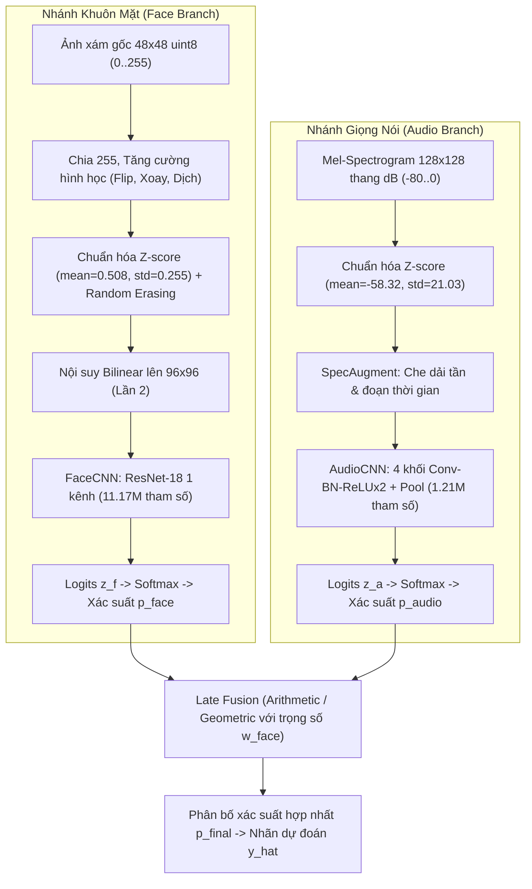
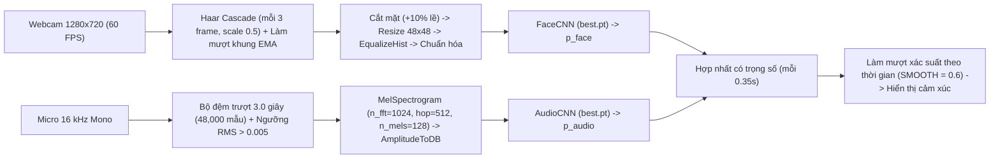

# Tài Liệu Chi Tiết Luồng Xử Lý Mô Hình, Tham Số & Hiệu Năng (Model Workflow)

Tài liệu này trình bày toàn bộ quy trình xử lý toán học, ý nghĩa từng ký hiệu, kiến trúc tham số chi tiết, báo cáo hiệu năng và phân tích nguyên nhân giúp **Lần huấn luyện 2 (`20261117`)** vượt trội so với **Lần huấn luyện 1 (`20261115`)** của hệ thống **Nhận diện cảm xúc đa phương thức (Khuôn mặt + Giọng nói — Late Fusion)**.

---

## 1. Tổng Quan Luồng Xử Lý (End-to-End Workflow)

### 1.1. Sơ đồ Huấn luyện & Đánh giá Offline



*(Sơ đồ dạng chữ trực quan nếu trình đọc Markdown không bật plugin Mermaid):*
```text
[NHÁNH KHUÔN MẶT - FACE BRANCH]                       [NHÁNH GIỌNG NÓI - AUDIO BRANCH]
F1: Ảnh xám gốc 48x48 uint8 (0..255)                  A1: Mel-Spectrogram 128x128 thang dB (-80..0)
  │                                                     │
  ▼                                                     ▼
F2: Chia 255 + Tăng cường hình học (Flip, Xoay, Dịch) A2: Chuẩn hóa Z-score (mean=-58.32, std=21.03)
  │                                                     │
  ▼                                                     ▼
F3: Chuẩn hóa Z-score (0.508, 0.255) + Random Erasing A3: SpecAugment (Che dải tần & đoạn thời gian)
  │                                                     │
  ▼                                                     ▼
F4: Nội suy Bilinear lên 96x96 (Lần 2)                A4: AudioCNN: 4 khối Conv-BN-ReLUx2 + Pool (1.21M)
  │                                                     │
  ▼                                                     ▼
F5: FaceCNN: ResNet-18 1 kênh (11.17M tham số)        A5: Logits z_a ──► Softmax ──► Xác suất p_audio
  │                                                     │
  ▼                                                     │
F6: Logits z_f ──► Softmax ──► Xác suất p_face          │
  │                                                     │
  └──────────────────────┬──────────────────────────────┘
                         ▼
         FUSE: Late Fusion (Arithmetic / Geometric với trọng số w_face)
                         │
                         ▼
         OUT:  Phân bố xác suất hợp nhất p_final ──► Nhãn dự đoán y_hat
```

#### Giải thích chi tiết từng bước trong sơ đồ `1.1`

##### A. Nhánh Khuôn Mặt (`Face Branch`: `F1` $\to$ `F6`)

- **Bước `F1` — Ảnh xám gốc `48x48 uint8 (0..255)` (`src/data_utils.py` — `load_face_split`):**
  - **Đầu vào:** Chuỗi văn bản `pixels` gồm `2,304` số nguyên cách nhau bởi khoảng trắng trong các file CSV (`face_train.csv`, `face_val.csv`, `face_test.csv`).
  - **Xử lý:** Hàm `_parse_pixels()` tách chuỗi, ép kiểu về số nguyên không dấu 8-bit (`uint8`), định hình lại (`reshape`) thành ma trận 2 chiều $(48, 48)$ và lưu đệm (`.npy` cache) để những lần chạy sau nạp tức thì. Đồng thời lọc giữ các mẫu có nhãn `label < num_classes` ($7$ lớp đầu).
  - **Đầu ra & Ý nghĩa:** Mảng ảnh mức xám kích thước $(48, 48)$, giá trị mỗi điểm ảnh thuộc $\{0, 1, \dots, 255\}$. Dùng 1 kênh độ sáng (grayscale) thay vì 3 kênh màu RGB giúp mô hình tập trung thuần túy vào cấu trúc hình thái cơ mặt (nếp nhăn trán, độ mở mắt, độ cong khóe miệng) và không bị phụ thuộc vào màu da hay nhiệt độ màu ánh sáng.

- **Bước `F2` — Chia `255`, Tăng cường hình học (`Flip`, `Xoay`, `Dịch`) (`src/datasets.py` — `FaceDataset.__getitem__`):**
  - **Đầu vào:** Mảng ảnh `uint8` $(48, 48)$ của từng mẫu.
  - **Xử lý:**
    1. Chuyển sang tensor thực `float32`, chia cho `255.0` để đưa miền giá trị về $[0.0, 1.0]$ và thêm chiều kênh thành $[1, 48, 48]$.
    2. Nếu đang ở pha huấn luyện (`train=True`), áp dụng chuỗi biến đổi hình học ngẫu nhiên (`self.geo`):
       - `RandomHorizontalFlip(p=0.5)`: lật ngang trái–phải với xác suất $50\%$ (vì biểu cảm khuôn mặt người có tính đối xứng gương).
       - `RandomAffine(degrees=10, translate=(0.05, 0.05))`: xoay ngẫu nhiên góc trong $[-10^\circ, +10^\circ]$ và tịnh tiến ngang/dọc tối đa $\pm 5\%$ ($\approx \pm 2.4$ pixel).
    3. Nếu ở pha đánh giá (`val` / `test`), **bỏ qua hoàn toàn** bước biến đổi ngẫu nhiên để đảm bảo kết quả đo lặp lại chính xác $100\%$.
  - **Đầu ra & Ý nghĩa:** Tensor $[1, 48, 48] \in [0, 1]$. Giúp mô hình bền vững khi đầu người dùng hơi nghiêng hoặc khung bắt mặt (bounding box) bị lệch tâm nhẹ.

- **Bước `F3` — Chuẩn hóa `Z-score (mean=0.508, std=0.255)` + `Random Erasing` (`src/datasets.py`):**
  - **Đầu vào:** Tensor $[1, 48, 48] \in [0, 1]$.
  - **Xử lý:**
    1. Trừ trung bình toàn cục tập train ($\mu_{\text{face}} = 0.50774$) và chia cho độ lệch chuẩn ($\sigma_{\text{face}} = 0.25501$), đưa phân bố điểm ảnh về tâm $0$, phương sai $1$ (miền giá trị xấp xỉ $[-1.99, +1.93]$).
    2. Nếu `train=True`, áp dụng `RandomErasing(p=0.25, scale=(0.02, 0.15), value=0)`: với xác suất $25\%$, chọn ngẫu nhiên một hình chữ nhật chiếm $2\% \to 15\%$ diện tích ảnh và gán toàn bộ pixel trong vùng đó bằng `0.0`. Vì thực hiện *sau* chuẩn hóa Z-score, giá trị `0.0` tương ứng chính xác với **mức xám trung bình** của tập dữ liệu (không tạo viền đen/trắng gắt giả tạo).
  - **Đầu ra & Ý nghĩa:** Tensor $[1, 48, 48]$ đã chuẩn hóa; khi ghép theo lô (`DataLoader`) thành $[B, 1, 48, 48]$. Bước xóa vùng ngẫu nhiên buộc mạng không được "học tủ" vào một vùng duy nhất (ví dụ chỉ nhìn miệng cười để đoán `happy`), mà phải kết hợp cả mắt, lông mày, gò má — đồng thời chịu được che khuất thực tế (gọng kính, tóc mái, tay chạm mặt).

- **Bước `F4` — Nội suy `Bilinear` lên `96x96` ở Lần 2 (`src/models.py` — `FaceCNN.forward`):**
  - **Đầu vào:** Batch tensor $[B, 1, 48, 48]$.
  - **Xử lý:** Kiểm tra nếu kích thước cạnh khác `self.input_size` ($96$ ở Lần 2), gọi `F.interpolate(x, size=(96, 96), mode="bilinear", align_corners=False)` để nội suy song tuyến 2 chiều mượt trên GPU.
  - **Đầu ra & Ý nghĩa:** Tensor $[B, 1, 96, 96]$. Do ResNet-18 thu nhỏ kích thước không gian tổng cộng $2^5 = 32$ lần qua các tầng, việc nâng đầu vào từ $48 \times 48$ lên $96 \times 96$ giúp bản đồ đặc trưng ở tầng sâu nhất giữ được lưới $3 \times 3$ (thay vì bị nén vụn còn $2 \times 2$), bảo toàn chi tiết vi biểu cảm và khớp với trường tiếp nhận của các bộ lọc tiền huấn luyện ImageNet.

- **Bước `F5` — `FaceCNN`: ResNet-18 1 kênh (`11.17M` tham số) (`src/models.py`):**
  - **Đầu vào:** Tensor $[B, 1, 96, 96]$.
  - **Xử lý:**
    1. Tầng đầu `conv1` ($7 \times 7$, `stride=2`) được đổi từ $3$ kênh sang $1$ kênh bằng cách lấy trung bình cộng trọng số RGB của ImageNet, giúp tận dụng ngay các bộ dò cạnh/góc sắc nét sẵn có.
    2. Đi qua `BatchNorm -> ReLU -> MaxPool` và 4 tầng khối dư (`layer1` $64$ kênh $\to$ `layer2` $128$ kênh $\to$ `layer3` $256$ kênh $\to$ `layer4` $512$ kênh). Các đường nối tắt (skip connections $x + \mathcal{F}(x)$) giúp truyền gradient sâu mà không suy giảm.
    3. `AdaptiveAvgPool2d((1, 1))` gộp không gian $[B, 512, 3, 3]$ thành vector đặc trưng khuôn mặt $512$ chiều $[B, 512]$.
    4. Đi qua `Dropout(p=0.4)` (tắt ngẫu nhiên $40\%$ chiều đặc trưng khi train để chống overfitting) rồi tầng tuyến tính `Linear(512 -> 7)` tính điểm phân lớp.
  - **Đầu ra & Ý nghĩa:** Vector điểm thô `logits` $z_f \in \mathbb{R}^{B \times 7}$ (mỗi phần tử là mức độ ủng hộ thô trên $(-\infty, +\infty)$ cho 1 trong 7 cảm xúc).

- **Bước `F6` — `Logits z_f -> Softmax -> Xác suất p_face` (`src/trainer.py` — `predict`):**
  - **Đầu vào:** Logits $z_f \in \mathbb{R}^{B \times 7}$.
  - **Xử lý:**
    - *Trong lúc train:* Đưa thẳng $z_f$ vào `CrossEntropyLoss(weight=inv_sqrt, label_smoothing=0.1)` để tính sai số và lan truyền ngược cập nhật $11.17\text{M}$ tham số.
    - *Trong lúc đánh giá / suy luận:* Áp dụng hàm mũ chuẩn hóa $\text{Softmax}(z_f)$ theo chiều lớp để biến điểm thô thành xác suất dương có tổng bằng $1$, lưu ra `probs_val.npy` và `probs_test.npy`.
  - **Đầu ra & Ý nghĩa:** Vector xác suất nhánh mặt $p_{\text{face}} = (p_{f,0}, \dots, p_{f,6}) \in (0, 1)^7$, $\sum_{c=0}^6 p_{f,c} = 1$, sẵn sàng đưa sang khối hợp nhất `FUSE`.

---

##### B. Nhánh Giọng Nói (`Audio Branch`: `A1` $\to$ `A5`)

- **Bước `A1` — `Mel-Spectrogram 128x128 thang dB (-80..0)` (`src/data_utils.py` — `load_audio_split`):**
  - **Đầu vào:** Đường dẫn `mel_path` trong `audio_{train,val,test}_proc.csv` trỏ tới các ma trận phổ `.npy` đã trích xuất từ các bộ dữ liệu giọng nói (`ASVP-ESD`, `CREMA-D`, `RAVDESS`).
  - **Xử lý:** Đọc toàn bộ ma trận $(128, 128)$, kiểm tra kích thước nghiêm ngặt, lưu cache dạng `float16` để tiết kiệm bộ nhớ và chuyển sang `float32` khi đưa vào Dataset.
  - **Đầu ra & Ý nghĩa:** Ảnh phổ âm thanh 2 chiều $(128, 128)$ trên miền $[-80, 0]\text{ dB}$:
    - Trục dọc ($128$ hàng): dải tần số thang **Mel** (phân giải cao ở tần số trầm–trung nơi chứa tần số cơ bản giọng nói $F_0$ và các đỉnh cộng hưởng formant, nén dần ở tần số cao giống tai người).
    - Trục ngang ($128$ cột): tiến trình thời gian của câu nói ($\approx 3$ giây).
    - Giá trị điểm ảnh: cường độ năng lượng logarit (decibel), giúp biến bài toán xử lý tín hiệu âm thanh 1D phức tạp thành bài toán nhận dạng mẫu thị giác 2D cho mạng CNN.

- **Bước `A2` — Chuẩn hóa `Z-score (mean=-58.32, std=21.03)` (`src/datasets.py` — `AudioDataset.__getitem__`):**
  - **Đầu vào:** Ma trận phổ $M_{\text{dB}} \in [-80, 0]^{128 \times 128}$.
  - **Xử lý:** Trừ trung bình tập train ($\mu_{\text{audio}} = -58.32314\text{ dB}$) và chia độ lệch chuẩn ($\sigma_{\text{audio}} = 21.02955\text{ dB}$).
  - **Đầu ra & Ý nghĩa:** Ma trận $(128, 128)$ có phân bố chuẩn hóa quanh $0$ (miền giá trị khoảng $[-1.03, +2.77]$). Vì dữ liệu gốc toàn số âm lớn ($-80 \to 0$), nếu không chuẩn hóa về tâm $0$, các tầng tích chập đầu tiên sẽ bị lệch hoạt hóa rất mạnh và hội tụ chậm.

- **Bước `A3` — `SpecAugment: Che dải tần & đoạn thời gian` (`src/datasets.py` — `_spec_augment`):**
  - **Đầu vào:** Ma trận phổ $(128, 128)$ đã chuẩn hóa Z-score.
  - **Xử lý:** Chỉ kích hoạt khi `train=True`. Lặp `n_masks = 2` lần:
    1. *Che dải tần (Frequency Masking):* chọn ngẫu nhiên một dải cao từ $0 \to 24$ hàng liên tiếp (Lần 2) và gán toàn bộ hàng đó dọc theo mọi thời điểm bằng `0.0`.
    2. *Che đoạn thời gian (Time Masking):* chọn ngẫu nhiên một đoạn rộng từ $0 \to 32$ cột liên tiếp (Lần 2) và gán toàn bộ cột đó trên mọi tần số bằng `0.0`.
    *(Sau đó thêm chiều kênh `unsqueeze(0)` thành $[1, 128, 128]$).*
  - **Đầu ra & Ý nghĩa:** Tensor $[B, 1, 128, 128]$. Đây là kỹ thuật tăng cường dữ liệu quyết định cho âm thanh: xóa bớt các dải tần đặc trưng của từng phòng thu/micro hoặc âm sắc cá nhân người nói, buộc mạng phải học **quy luật ngữ điệu cảm xúc tổng thể** (nhịp nhanh/chậm, độ vút cao độ khi giận dữ/ngạc nhiên, âm trầm kéo dài khi buồn).

- **Bước `A4` — `AudioCNN: 4 khối Conv-BN-ReLUx2 + Pool (1.21M tham số)` (`src/models.py`):**
  - **Đầu vào:** Tensor $[B, 1, 128, 128]$.
  - **Xử lý:**
    1. Đi qua 4 khối tích chập kiểu VGG thu gọn: tăng số kênh $1 \to 32 \to 64 \to 128 \to 256$, mỗi khối gồm 2 lớp `Conv2d(3x3) + BatchNorm2d + ReLU` nối tiếp rồi `MaxPool2d(2x2)` giảm nửa cả chiều tần số lẫn thời gian ($128 \to 64 \to 32 \to 16 \to 8$).
    2. `AdaptiveAvgPool2d(1)` gom bản đồ $[B, 256, 8, 8]$ thành vector đặc trưng âm học $256$ chiều $[B, 256]$.
    3. Đi qua nhánh phân loại `head`: `Dropout(0.45) -> Linear(256, 128) -> ReLU -> Dropout(0.45) -> Linear(128, 7)`.
  - **Đầu ra & Ý nghĩa:** Vector điểm thô `logits` $z_a \in \mathbb{R}^{B \times 7}$. Thiết kế `1.21M` tham số gọn nhẹ giúp huấn luyện từ đầu (scratch) trên `13,094` mẫu âm thanh không bị quá khớp như các mạng hàng chục triệu tham số, đồng thời suy luận cực nhanh trên CPU khi chạy thời gian thực.

- **Bước `A5` — `Logits z_a -> Softmax -> Xác suất p_audio` (`src/trainer.py` — `predict`):**
  - **Đầu vào:** Logits $z_a \in \mathbb{R}^{B \times 7}$.
  - **Xử lý:** Huấn luyện bằng `CrossEntropyLoss(weight=inv_sqrt, label_smoothing=0.1)`; khi đánh giá/suy luận áp $\text{Softmax}(z_a)$ và lưu `probs_val.npy`, `probs_test.npy`.
  - **Đầu ra & Ý nghĩa:** Phân bố xác suất nhánh tiếng $p_{\text{audio}} = (p_{a,0}, \dots, p_{a,6}) \in (0, 1)^7$, $\sum_{c=0}^6 p_{a,c} = 1$, cùng không gian $7$ nhãn chuẩn với nhánh mặt.

---

##### C. Khối Hợp Nhất & Quyết Định Cuối (`FUSE` $\to$ `OUT`)

- **Bước `FUSE` — `Late Fusion (Arithmetic / Geometric với trọng số w_face)` (`fuse_eval.py`):**
  - **Đầu vào:** Cặp vector xác suất $p_{\text{face}} \in (0, 1)^7$ (từ `F6`) và $p_{\text{audio}} \in (0, 1)^7$ (từ `A5`), cùng trọng số $w_{\text{face}} \in [0, 1]$ (trọng số tối ưu tìm được trên tập `val` là $w_{\text{face}} = 0.5$, tức đóng góp cân bằng $50\% - 50\%$).
  - **Xử lý:**
    - Vì bộ dữ liệu mặt và tiếng độc lập nhau, `make_pairs()` ghép ngẫu nhiên không lặp $n_c = \min(n_{\text{face}, c}, n_{\text{audio}, c})$ cặp mẫu cùng nhãn cảm xúc $c$ (lặp lại trên $20$ `seeds` độc lập để tính trung bình $\pm$ độ lệch chuẩn khách quan).
    - Kết hợp hai phân bố xác suất theo 1 trong 2 cơ chế:
      - *Lần 1 (`arithmetic` — trung bình cộng):* $p_{\text{final}} = w_{\text{face}} \cdot p_{\text{face}} + (1 - w_{\text{face}}) \cdot p_{\text{audio}}$.
      - *Lần 2 (`geometric` — trung bình nhân chuẩn hóa):* tính tổng có trọng số trên miền logarit $\ell_c = w_{\text{face}} \ln p_{f,c} + (1 - w_{\text{face}}) \ln p_{a,c}$ rồi chuẩn hóa lại bằng hàm mũ $\exp(\ell_c) / \sum_j \exp(\ell_j)$.
  - **Đầu ra & Ý nghĩa:** Vector xác suất đa phương thức hợp nhất $p_{\text{final}} \in (0, 1)^7$. Nhánh mặt rất giỏi nhận diện các biểu cảm rõ khẩu hình (`happy`, `surprise`, `disgust`), trong khi nhánh tiếng bổ trợ mạnh về cường độ cảm xúc (`angry`, `sad`, `fear`); khi hợp nhất bằng `geometric`, hai nhánh kiểm chứng chéo và triệt tiêu sai số đơn lẻ.

- **Bước `OUT` — `Phân bố xác suất hợp nhất p_final -> Nhãn dự đoán y_hat`:**
  - **Đầu vào:** Vector xác suất hợp nhất $p_{\text{final}} = (p_0, p_1, \dots, p_6)$.
  - **Xử lý:** Chọn chỉ số lớp có xác suất lớn nhất $\hat{y} = \arg\max_{c \in \{0..6\}} p_{\text{final}, c}$, tra bảng nhãn chuẩn `EMOTIONS` / `EMOTIONS_VI` (`0: angry/Giận dữ`, `1: disgust/Ghê tởm`, `2: fear/Sợ hãi`, `3: happy/Vui vẻ`, `4: sad/Buồn`, `5: surprise/Ngạc nhiên`, `6: neutral/Trung tính`).
  - **Đầu ra & Ý nghĩa:** Nhãn cảm xúc dự đoán cuối cùng $\hat{y}$ kèm độ tự tin phần trăm ($p_{\text{final}, \hat{y}} \times 100\%$), dùng để tính Ma trận nhầm lẫn, Accuracy, Macro-F1 (khi đánh giá offline) hoặc hiển thị trực tiếp lên màn hình (khi chạy demo thời gian thực).

### 1.2. Sơ đồ Suy luận Thời gian thực (`app_realtime_fusion.py`)



---

## 2. Bảng Giải Thích Chi Tiết Từng Ký Hiệu (Symbol & Notation Glossary)

| Ký hiệu | Tên trong Code | Ý nghĩa chi tiết & Đơn vị / Miền giá trị |
|---|---|---|
| $B$ | `batch_size`, `bs` | Số lượng mẫu trong một lô huấn luyện ($B = 128$ cho Face, $B = 64$ cho Audio). |
| $C_{\text{in}}, C_{\text{out}}$ | `cin`, `cout` | Số kênh đặc trưng đầu vào và đầu ra của tầng tích chập (`Conv2d`). |
| $H, W$ | `h`, `w` | Chiều cao và chiều rộng không gian của ảnh mặt ($48 \times 48$ hoặc $96 \times 96$), hoặc trục **Tần số Mel $\times$ Thời gian** của phổ âm thanh ($128 \times 128$). |
| $K$ | `num_classes`, `n` | Tổng số lớp cảm xúc phân loại ($K = 7$: `angry`, `disgust`, `fear`, `happy`, `sad`, `surprise`, `neutral`; mở rộng tối đa $10$). |
| $N$ | `len(ds)` | Tổng số mẫu trong một tập dữ liệu (`train`, `val`, hoặc `test`). |
| $n_c$ | `counts[c]` | Số lượng mẫu thuộc lớp cảm xúc thứ $c \in \{0, \dots, K-1\}$ trong tập `train`. |
| $\mu, \sigma$ | `mean`, `std` | Giá trị trung bình và độ lệch chuẩn toàn cục tính trên toàn bộ pixel/bin của tập `train` để chuẩn hóa đầu vào. |
| $x$ | `x` | Tensor đầu vào đã chuẩn hóa: nhánh mặt có kích thước $[B, 1, H, W]$, nhánh tiếng có kích thước $[B, 1, 128, 128]$. |
| $z = (z_0, \dots, z_{K-1})$ | `logits` | Vector điểm thô (chưa chuẩn hóa xác suất) ở đầu ra tầng tuyến tính cuối cùng (`Linear`), $z \in \mathbb{R}^{K}$. |
| $p = (p_0, \dots, p_{K-1})$ | `probs`, `p_f`, `p_a` | Phân bố xác suất sau hàm `Softmax`, thỏa mãn $p_c \in (0, 1)$ và $\sum_{c=0}^{K-1} p_c = 1$. |
| $y \in \{0, \dots, K-1\}$ | `y`, `y_true` | Nhãn cảm xúc thực tế (ground-truth) của mẫu dữ liệu. |
| $\hat{y}$ | `pred`, `k` | Nhãn cảm xúc do mô hình dự đoán: $\hat{y} = \arg\max_{c} p_c$. |
| $\varepsilon$ | `label_smoothing` | Hệ số làm mượt nhãn ($\varepsilon = 0.1$), ngăn mô hình đẩy xác suất về cực đoan $0$ hoặc $1$. |
| $q_c$ | — | Phân bố nhãn mục tiêu sau khi làm mượt (smoothed target distribution). |
| $w_c$ | `weights` | Trọng số bù mất cân bằng dữ liệu của lớp $c$ trong hàm mất mát Cross-Entropy (`inv_sqrt`). |
| $\mathcal{L}$ | `loss` | Giá trị hàm mất mát trung bình trên batch hoặc trên tập đánh giá. |
| $\theta$ | `params`, `w` | Tập các tensor tham số huấn luyện được của mạng nơ-ron. |
| $g = \nabla_\theta \mathcal{L}$ | `grads` | Gradient của hàm mất mát theo tham số $\theta$. |
| $\|g\|_2$ | `gnorm`, `grad_norm` | Chuẩn Euclid ($L_2$-norm) toàn cục của vector gradient trước/sau khi cắt ngưỡng (`grad_clip = 1.0`). |
| $\eta_t$ | `lr` | Tốc độ học (Learning Rate) tại bước cập nhật thứ $t$. |
| $\lambda$ | `weight_decay` | Hệ số phạt chuẩn $L_2$ tách rời trong thuật toán tối ưu `AdamW`. |
| $\Delta \theta$ | `delta_norm` | Độ dịch chuyển tham số sau 1 epoch: $\|\theta^{(e)} - \theta^{(e-1)}\|_2$. |
| $r_{\text{upd}}$ | `update_ratio` | Tỷ lệ cập nhật tương đối của từng tensor tham số: $\frac{\|\theta^{(e)} - \theta^{(e-1)}\|_2}{\|\theta^{(e-1)}\|_2 + 10^{-12}}$. |
| $w_{\text{face}}$ | `w_face`, `w` | Trọng số đóng góp của nhánh khuôn mặt khi hợp nhất ($w_{\text{face}} \in [0, 1]$); nhánh tiếng nhận trọng số $1 - w_{\text{face}}$. |
| $\alpha$ | `SMOOTH` | Hệ số làm mượt trung bình trượt mũ (EMA) theo thời gian thực ($\alpha = 0.6$ cho xác suất, $0.7$ cho khung mặt). |
| $\text{RMS}$ | `mic_level` | Căn bậc hai trung bình bình phương biên độ sóng âm thanh, đo năng lượng giọng nói thu từ micro. |
| $\text{TP}_c, \text{FP}_c, \text{FN}_c$ | `tp`, `cm` | Số mẫu dự đoán Đúng dương tính, Dương tính giả, Âm tính giả đối với lớp $c$ trên ma trận nhầm lẫn. |

---

## 3. Giải Thích Chi Tiết Từng Bước Xử Lý Toán Học

### Bước 1: Tiền xử lý, Chuẩn hóa & Tăng cường dữ liệu (`src/data_utils.py`, `src/datasets.py`)

#### 1.1. Tính thống kê toàn cục trên tập Train
Để tránh rò rỉ dữ liệu (data leakage), trung bình $\mu$ và độ lệch chuẩn $\sigma$ **chỉ được tính duy nhất trên tập `train`** theo từng khối (`chunk = 1024`):

$$\mu = \frac{1}{M} \sum_{i=1}^{M} \frac{u_i}{S}, \qquad \sigma = \sqrt{\max\left(\frac{1}{M}\sum_{i=1}^{M}\left(\frac{u_i}{S}\right)^2 - \mu^2,\; 10^{-12}\right)}$$

Trong đó $M$ là tổng số phần tử điểm ảnh / điểm phổ trên toàn bộ tập `train`, $S = 255.0$ cho ảnh mặt (`uint8` $\to [0, 1]$) và $S = 1.0$ cho Mel-spectrogram (đã ở thang dB $[-80, 0]$):
- **Nhánh Mặt:** $\mu_{\text{face}} = 0.50774$, $\sigma_{\text{face}} = 0.25501$.
- **Nhánh Tiếng:** $\mu_{\text{audio}} = -58.32314\text{ dB}$, $\sigma_{\text{audio}} = 21.02955\text{ dB}$.

#### 1.2. Xử lý một mẫu Nhánh Mặt (`FaceDataset`)
1. Đọc mảng điểm ảnh xám $I \in \{0, \dots, 255\}^{48 \times 48}$, đưa về thực $[0, 1]$ và thêm chiều kênh: $x_0 = I / 255.0 \in \mathbb{R}^{1 \times 48 \times 48}$.
2. **Tăng cường hình học (chỉ bật khi `train=True`):**
   - Lật ngang ngẫu nhiên (`RandomHorizontalFlip`, xác suất $0.5$).
   - Biến đổi Affine ngẫu nhiên (`RandomAffine`): xoay trong khoảng $[-10^\circ, +10^\circ]$ và dịch chuyển tối đa $\pm 5\%$ theo chiều ngang/dọc.
3. **Chuẩn hóa Z-score:**
   $$x = \frac{\tilde{x}_0 - \mu_{\text{face}}}{\sigma_{\text{face}}}$$
4. **Xóa vùng ngẫu nhiên (`RandomErasing`, `p = 0.25`):** Che ngẫu nhiên một vùng chữ nhật diện tích từ $2\% \to 15\%$ ảnh bằng giá trị $0$ (tương đương độ sáng trung bình $\mu_{\text{face}}$), buộc mạng không phụ thuộc duy nhất vào mắt hoặc miệng (mô phỏng che khuất thực tế như đeo kính, tay che mặt).

#### 1.3. Xử lý một mẫu Nhánh Tiếng (`AudioDataset` & Real-time Mel)
- **Từ sóng âm sang phổ Mel (trong suy luận thực tế):** Với đoạn âm thanh $s(t)$ dài $3.0\text{s}$ ở tần số lấy mẫu $f_s = 16,000\text{ Hz}$ ($48,000$ mẫu), biến đổi STFT dùng cửa sổ $n_{\text{fft}} = 1024$ ($\approx 64\text{ ms}$), bước nhảy $\text{hop\_length} = 512$ ($\approx 32\text{ ms}$), chiếu qua bộ lọc $128$ dải tần Mel và đổi sang thang năng lượng logarit decibel (`top_db = 80`):
  $$M_{\text{dB}}(f, \tau) = 10 \log_{10}\big(\max(S_{\text{Mel}}(f, \tau), 10^{-10})\big), \quad \text{giới hạn trong khoảng } [\max(M_{\text{dB}}) - 80,\; \max(M_{\text{dB}})]$$
  Sau đó nội suy song tuyến về đúng lưới $128 \times 128$.
- **Chuẩn hóa Z-score:** $x = (M_{\text{dB}} - \mu_{\text{audio}}) / \sigma_{\text{audio}}$.
- **Tăng cường phổ `SpecAugment` (chỉ bật khi `train=True`):** Lặp `n_masks = 2` lần:
  - *Frequency Masking:* chọn độ rộng ngẫu nhiên $m_f \sim \mathcal{U}\{0, \dots, F_{\max}\}$ và vị trí $s_f$, gán $x[s_f : s_f + m_f, :] = 0$.
  - *Time Masking:* chọn độ rộng ngẫu nhiên $m_t \sim \mathcal{U}\{0, \dots, T_{\max}\}$ và vị trí $s_t$, gán $x[:, s_t : s_t + m_t] = 0$.

---

### Bước 2: Truyền Tiến Qua Hai Nhánh Mạng (`src/models.py`)

#### 2.1. Nhánh Khuôn Mặt — `FaceCNN` (Modified ResNet-18)
1. **Nội suy kích thước đầu vào:** Nếu kích thước không gian hiện tại khác `input_size` (ở Lần 2 là $96$), nội suy song tuyến hai chiều (`bilinear`):
   $$x \in \mathbb{R}^{B \times 1 \times 48 \times 48} \xrightarrow{\text{Bilinear}} \mathbb{R}^{B \times 1 \times 96 \times 96}$$
2. **Tầng tích chập đầu tiên cho ảnh xám (`conv1`):** Thay `Conv2d(3, 64, 7x7)` của ResNet-18 gốc bằng `Conv2d(1, 64, 7x7, stride=2, padding=3)`. Để giữ tri thức tiền huấn luyện trên ImageNet, trọng số kênh xám được khởi tạo bằng **trung bình cộng 3 kênh RGB**:
   $$W_{\text{conv1}}^{(1)} = \frac{1}{3} \sum_{c \in \{R, G, B\}} W_{\text{ImageNet}}^{(c)} \in \mathbb{R}^{64 \times 1 \times 7 \times 7}$$
3. **Các khối dư (`BasicBlock` $\times 8$ trong `layer1..layer4`):** Mỗi khối tính $y = \text{ReLU}(\mathcal{F}(x) + \mathcal{S}(x))$, trong đó kết nối tắt $\mathcal{S}(x)$ giúp dòng gradient truyền thẳng về các tầng đầu mà không bị triệt tiêu (vanishing gradient).
4. **Gộp trung bình toàn cục & Phân loại:** `AdaptiveAvgPool2d(1)` gom bản đồ đặc trưng $[B, 512, 3, 3]$ về vector đặc trưng $[B, 512]$, đi qua `Dropout(p)` rồi tầng tuyến tính `Linear(512, 7)` sinh ra logits $z^{(f)} \in \mathbb{R}^{B \times 7}$.

#### 2.2. Nhánh Giọng Nói — `AudioCNN` (4-Block VGG-style CNN)
1. Gồm 4 khối liên tiếp với số kênh tăng gấp đôi $1 \to 32 \to 64 \to 128 \to 256$. Mỗi khối gồm **2 cụm** `Conv2d(3x3, pad=1) -> BatchNorm2d -> ReLU` (tăng trường tiếp nhận hiệu dụng lên $5 \times 5$ trên mỗi khối nhưng ít tham số hơn) theo sau bởi `MaxPool2d(2)` giảm một nửa cả chiều tần số lẫn thời gian:
   $$[B, 1, 128, 128] \to [B, 32, 64, 64] \to [B, 64, 32, 32] \to [B, 128, 16, 16] \to [B, 256, 8, 8]$$
2. `AdaptiveAvgPool2d(1)` nén $[B, 256, 8, 8] \to [B, 256, 1, 1]$.
3. **Đầu phân loại (`head`):** `Flatten -> Dropout(p) -> Linear(256, 128) -> ReLU -> Dropout(p) -> Linear(128, 7)` tạo ra logits $z^{(a)} \in \mathbb{R}^{B \times 7}$.

#### 2.3. Chuyển Logits thành Phân bố Xác suất (`Softmax`)
Với vector logits $z = (z_0, \dots, z_{K-1})$, xác suất lớp $c$ là:
$$p_c = \text{Softmax}(z)_c = \frac{e^{z_c - z_{\max}}}{\sum_{j=0}^{K-1} e^{z_j - z_{\max}}}, \qquad z_{\max} = \max_{j} z_j \text{ (ổn định số học)}$$

---

### Bước 3: Hàm Mất Mát, Tối Ưu Hóa & Lịch Tốc Độ Học (`src/trainer.py`)

#### 3.1. Trọng số bù mất cân bằng lớp (`class_weight = inv_sqrt`)
Do dữ liệu lệch mạnh giữa các lớp (ví dụ tập Face `train` có `happy = 7,215` mẫu nhưng `disgust = 436` mẫu — gấp $16.5$ lần), hệ thống tính trọng số nghịch đảo căn bậc hai rồi chuẩn hóa để trung bình bằng $1$:
$$\tilde{w}_c = \sqrt{\frac{N}{K \cdot n_c}}, \qquad w_c = \frac{\tilde{w}_c}{\frac{1}{K}\sum_{j=0}^{K-1} \tilde{w}_j}$$
- **Trọng số thực tế Nhánh Mặt:** `angry=0.81, disgust=2.44, fear=0.80, happy=0.60, sad=0.73, surprise=0.90, neutral=0.72`.
- **Trọng số thực tế Nhánh Tiếng:** `angry=0.94, disgust=1.31, fear=0.98, happy=0.91, sad=0.74, surprise=1.20, neutral=0.91`.

*(Dùng `inv_sqrt` thay vì `inv` thuần túy giúp ưu tiên lớp hiếm như `disgust` mà không làm nổ phương sai gradient khi gặp mẫu nhiễu ở lớp hiếm).*

#### 3.2. Hàm mất mát Weighted Cross-Entropy kèm Label Smoothing
Với nhãn thật $y$ và hệ số làm mượt $\varepsilon = 0.1$, phân bố mục tiêu mềm là:
$$q_c = \begin{cases} 1 - \varepsilon + \frac{\varepsilon}{K}, & \text{nếu } c = y \\ \frac{\varepsilon}{K}, & \text{nếu } c \neq y \end{cases}$$
Với $K = 7$, lớp đúng nhận $q_y = 0.9 + \frac{0.1}{7} \approx 0.9143$, mỗi lớp còn lại nhận $\approx 0.0143$. Hàm mất mát của một mẫu trong PyTorch `CrossEntropyLoss(weight=w, label_smoothing=0.1)` kết hợp hai thành phần:
$$\ell(z, y) = -(1 - \varepsilon) w_y \log p_y - \frac{\varepsilon}{K} \sum_{c=0}^{K-1} w_c \log p_c$$
Giá trị này giúp mô hình **không quá tự tin (overconfident)** — yếu tố cực kỳ quan trọng khi ghép xác suất hai nhánh ở giai đoạn Late Fusion.

#### 3.3. Tối ưu hóa `AdamW`, Mixed Precision (`AMP`) & Cắt Gradient (`Grad Clipping`)
- **Phân tách nhóm tham số (`make_optimizer`):**
  - Nhóm `decay` (`p.ndim > 1`, gồm ma trận trọng số `Conv2d` và `Linear`): áp dụng `weight_decay` $\lambda$.
  - Nhóm `no_decay` (`p.ndim <= 1`, gồm `bias` và tham số thang/dịch $\gamma, \beta$ của `BatchNorm2d`): đặt `weight_decay = 0.0` (tránh làm co méo mặt chuẩn hóa của BatchNorm).
- **AMP (`float16`) + `GradScaler`:** Tăng tốc tính toán trên GPU; trước khi đo và cắt gradient, `scaler.unscale_(optimizer)` đưa gradient về đúng biên độ thực.
- **Cắt chuẩn Gradient (`clip_grad_norm_` với ngưỡng $G_{\max} = 1.0$):**
  $$g \leftarrow g \cdot \min\left(1,\; \frac{G_{\max}}{\|g\|_2 + 10^{-6}}\right)$$
  Đảm bảo một batch có nhiễu lớn không đẩy trọng số văng khỏi vùng hội tụ.

#### 3.4. Lịch tốc độ học Linear Warmup + Cosine Annealing (`make_scheduler`)
Gọi $T$ là tổng số bước huấn luyện (`epochs * steps_per_epoch`), $T_w$ là số bước khởi động (`warmup_epochs = 3`), và $r_{\min} = 0.01$ (`min_lr_ratio`). Tại bước $t \in [0, T-1]$, tốc độ học $\eta_t = \eta_0 \cdot \phi(t)$ với:
$$\phi(t) = \begin{cases} \dfrac{t + 1}{T_w}, & \text{nếu } t < T_w \quad \text{(tăng tuyến tính khởi động)} \\[8pt] r_{\min} + (1 - r_{\min}) \cdot \dfrac{1}{2}\left(1 + \cos\left(\pi \cdot \dfrac{t - T_w}{T - T_w}\right)\right), & \text{nếu } t \ge T_w \quad \text{(hạ dần hình cosin)} \end{cases}$$

---

### Bước 4: Hợp Nhất Đa Phương Thức (Late Fusion) & Chỉ Số Đánh Giá

#### 4.1. Hai phương pháp Late Fusion (`fuse_eval.py`)
Cho phân bố xác suất nhánh mặt $p^{(f)} \in \mathbb{R}^K$, nhánh tiếng $p^{(a)} \in \mathbb{R}^K$ và trọng số mặt $w \in [0, 1]$:

1. **Trung bình cộng tuyến tính (`arithmetic`):**
   $$p_c^{\text{arith}} = w \cdot p_c^{(f)} + (1 - w) \cdot p_c^{(a)}$$
2. **Trung bình nhân chuẩn hóa / Cộng log-xác suất (`geometric`):**
   $$\ell_c = w \ln\big(\max(p_c^{(f)}, 10^{-9})\big) + (1 - w) \ln\big(\max(p_c^{(a)}, 10^{-9})\big)$$
   $$p_c^{\text{geom}} = \frac{\exp(\ell_c - \ell_{\max})}{\sum_{j=0}^{K-1} \exp(\ell_j - \ell_{\max})} \propto \left(p_c^{(f)}\right)^w \cdot \left(p_c^{(a)}\right)^{1-w}$$

#### 4.2. Xử lý làm mượt trong Suy luận Thời gian thực (`app_realtime_fusion.py`)
- **Làm mượt vị trí khung mặt (EMA Box):** $b_t = 0.7\, b_{t-1} + 0.3\, b_{\text{new}}$, chống rung khung xanh ở tốc độ 60 FPS.
- **Ngưỡng kích hoạt tiếng nói:** $\text{RMS} = \sqrt{\frac{1}{L}\sum_{i=1}^{L} s_i^2} > 0.005$ ($L = 48,000$ mẫu). Nếu không có tiếng, hệ thống tự chuyển sang `FACE-ONLY`; nếu mất mặt quá `1.0s`, tự chuyển sang `AUDIO-ONLY`.
- **Làm mượt xác suất dự đoán (EMA Probabilities):**
  $$\bar{p}_t = \alpha \cdot \bar{p}_{t-1} + (1 - \alpha) \cdot p_{\text{final}, t}, \qquad (\alpha = 0.6)$$

#### 4.3. Các chỉ số đánh giá (`src/metrics.py`)
Với ma trận nhầm lẫn $M \in \mathbb{N}^{K \times K}$ trong đó $M_{i, j}$ là số mẫu nhãn thật $i$ được dự đoán thành $j$:
- **Precision, Recall, F1 từng lớp $c$:**
  $$P_c = \frac{M_{c,c}}{\sum_{i=0}^{K-1} M_{i,c}}, \qquad R_c = \frac{M_{c,c}}{\sum_{j=0}^{K-1} M_{c,j}}, \qquad \text{F1}_c = \frac{2 P_c R_c}{P_c + R_c}$$
- **Accuracy (Độ chính xác tổng thể):** $\text{Acc} = \frac{1}{N} \sum_{c=0}^{K-1} M_{c,c}$.
- **Macro-F1 (Thước đo chính để chọn `best.pt` & Early Stopping):** $\text{Macro-F1} = \frac{1}{K} \sum_{c=0}^{K-1} \text{F1}_c$ — coi trọng ngang nhau cả lớp nhiều mẫu (`happy`) lẫn lớp ít mẫu (`disgust`).
- **Balanced Accuracy:** $\text{Bal-Acc} = \frac{1}{K} \sum_{c=0}^{K-1} R_c$ (trung bình Recall các lớp).
- **Negative Log-Likelihood (NLL Loss đánh giá):** $\text{NLL} = -\frac{1}{N} \sum_{i=1}^{N} \ln \max(p_{i, y_i}, 10^{-12})$ — đo cả độ chính xác lẫn chất lượng hiệu chỉnh xác suất (calibration).

---

## 4. Tham Số Mô Hình Chi Tiết (Model Parameters)

Tổng số tham số toàn hệ thống đa phương thức là **12,380,270 tham số** (~12.38 triệu, 100% huấn luyện được).

### 4.1. Kiến trúc & Số lượng tham số Nhánh Mặt — `FaceCNN` (`11,173,831` tham số)

*Kích thước Tensor bên dưới tính theo cấu hình Lần 2 (`input_size = 96`, $K = 7$).*

| Tầng / Khối | Cấu trúc chi tiết | Shape đầu ra | Công thức tham số | Số tham số |
|---|---|---|---|---:|
| **Input + Resize** | Ảnh xám chuẩn hóa $\to$ Bilinear $96\times96$ | $[B, 1, 96, 96]$ | — | `0` |
| **`conv1` + `bn1`** | `Conv2d(1, 64, 7x7, s=2, p=3)` + `BN(64)` + `ReLU` | $[B, 64, 48, 48]$ | $(1\times64\times49) + (2\times64)$ | `3,264` |
| **`maxpool`** | `MaxPool2d(3x3, stride=2, padding=1)` | $[B, 64, 24, 24]$ | — | `0` |
| **`layer1`** | $2 \times \text{BasicBlock}(64 \to 64, 3\times3)$ | $[B, 64, 24, 24]$ | $4 \times (64\times64\times9 + 128)$ | `147,968` |
| **`layer2`** | $2 \times \text{BasicBlock}(64 \to 128, s=2)$ + `downsample 1x1` | $[B, 128, 12, 12]$ | Khối 0 (`230,144`) + Khối 1 (`295,424`) | `525,568` |
| **`layer3`** | $2 \times \text{BasicBlock}(128 \to 256, s=2)$ + `downsample 1x1` | $[B, 256, 6, 6]$ | Khối 0 (`919,040`) + Khối 1 (`1,180,672`) | `2,099,712` |
| **`layer4`** | $2 \times \text{BasicBlock}(256 \to 512, s=2)$ + `downsample 1x1` | $[B, 512, 3, 3]$ | Khối 0 (`3,673,088`) + Khối 1 (`4,720,640`) | `8,393,728` |
| **`avgpool`** | `AdaptiveAvgPool2d((1, 1))` | $[B, 512, 1, 1]$ | — | `0` |
| **`fc`** | `Dropout(0.4)` $\to$ `Linear(512, 7, bias=True)` | $[B, 7]$ | $512 \times 7 + 7$ | `3,591` |
| **Tổng `FaceCNN`** | **ResNet-18 Pretrained ImageNet (1 kênh xám)** | **$[B, 7]$** | **Huấn luyện được: 100%** | **`11,173,831`** |

### 4.2. Kiến trúc & Số lượng tham số Nhánh Tiếng — `AudioCNN` (`1,206,439` tham số)

| Tầng / Khối | Cấu trúc chi tiết | Shape đầu ra | Công thức tham số | Số tham số |
|---|---|---|---|---:|
| **Input** | Mel-Spectrogram (dB) chuẩn hóa + SpecAugment | $[B, 1, 128, 128]$ | — | `0` |
| **`features.0`** | `(Conv(1->32, 3x3) + BN + ReLU)` $\to$ `(Conv(32->32) + BN + ReLU)` $\to$ `MaxPool(2)` | $[B, 32, 64, 64]$ | $(288+64) + (9,216+64)$ | `9,632` |
| **`features.1`** | `(Conv(32->64, 3x3) + BN + ReLU)` $\to$ `(Conv(64->64) + BN + ReLU)` $\to$ `MaxPool(2)` | $[B, 64, 32, 32]$ | $(18,432+128) + (36,864+128)$ | `55,552` |
| **`features.2`** | `(Conv(64->128, 3x3) + BN + ReLU)` $\to$ `(Conv(128->128) + BN + ReLU)` $\to$ `MaxPool(2)` | $[B, 128, 16, 16]$ | $(73,728+256) + (147,456+256)$ | `221,696` |
| **`features.3`** | `(Conv(128->256, 3x3) + BN + ReLU)` $\to$ `(Conv(256->256) + BN + ReLU)` $\to$ `MaxPool(2)` | $[B, 256, 8, 8]$ | $(294,912+512) + (589,824+512)$ | `885,760` |
| **`features.4`** | `AdaptiveAvgPool2d(1)` | $[B, 256, 1, 1]$ | — | `0` |
| **`head`** | `Flatten` $\to$ `Dropout(0.45)` $\to$ `Linear(256, 128)` $\to$ `ReLU` $\to$ `Dropout(0.45)` $\to$ `Linear(128, 7)` | $[B, 7]$ | $(256\times128+128) + (128\times7+7)$ | `33,799` |
| **Tổng `AudioCNN`** | **4-Block VGG-style CNN từ đầu (scratch)** | **$[B, 7]$** | **Huấn luyện được: 100%** | **`1,206,439`** |

### 4.3. Bảng Đối Chiếu Toàn Bộ Siêu Tham Số Huấn Luyện (Lần 1 vs. Lần 2)

| Tham số cấu hình | Face Lần 1 (`20261115`) | Face Lần 2 (`20261117`) | Audio Lần 1 (`20261115`) | Audio Lần 2 (`20261117`) |
|---|---|---|---|---|
| **`model.input_size`** | `48` | **`96`** ⬆️ | — (`128x128`) | — (`128x128`) |
| **`model.dropout`** | `0.20` | **`0.40`** ⬆️ | `0.30` | **`0.45`** ⬆️ |
| **`train.lr` ($\eta_0$)** | `0.001` (`1e-3`) | **`0.0005` (`5e-4`)** ⬇️ | `0.001` (`1e-3`) | `0.001` (`1e-3`) |
| **`train.weight_decay` ($\lambda$)** | `0.0001` (`1e-4`) | **`0.001` (`1e-3`)** ⬆️ | `0.0001` (`1e-4`) | **`0.001` (`1e-3`)** ⬆️ |
| **`augment.freq_mask`** | — | — | `16` | **`24`** ⬆️ |
| **`augment.time_mask`** | — | — | `24` | **`32`** ⬆️ |
| **`augment.n_masks`** | — | — | `2` | `2` |
| **Augment ảnh mặt** | Flip, Rot $10^\circ$, Trans $5\%$, Erase $0.25$ | Giữ nguyên | — | — |
| **`batch_size` / `optimizer`** | `128` / `AdamW` | `128` / `AdamW` | `64` / `AdamW` | `64` / `AdamW` |
| **`warmup_epochs` / `epochs`** | `3` / `60` | `3` / `60` | `3` / `60` | `3` / `60` |
| **`label_smoothing` / `class_weight`** | `0.1` / `inv_sqrt` | `0.1` / `inv_sqrt` | `0.1` / `inv_sqrt` | `0.1` / `inv_sqrt` |
| **`early_stop_patience`** | `12` (`val_macro_f1`) | `12` (`val_macro_f1`) | `12` (`val_macro_f1`) | `12` (`val_macro_f1`) |
| **Epoch đạt `best.pt` / Tổng chạy** | Epoch `48` / dừng ở `60` | **Epoch `21`** / dừng ở `33` | Epoch `43` / dừng ở `55` | **Epoch `56`** / chạy đủ `60` |
| **Phương pháp Late Fusion** | `arithmetic` ($w=0.5$) | **`geometric` ($w=0.5$)** | `arithmetic` ($w=0.5$) | **`geometric` ($w=0.5$)** |

---

## 5. Tại Sao Lần Train 2 (`20261117`) Có Kết Quả Tốt Hơn Lần Train 1 (`20261115`)?

Sự bứt phá tổng thể từ **75.09% lên 82.13% (+7.05% Accuracy trên Test)** và **Macro-F1 từ 73.16% lên 78.95% (+5.79%)** đến từ **3 cải tiến cốt lõi nối tiếp nhau**:

### Nguyên nhân 1: Khắc phục "nút thắt cổ chai không gian" & Overfitting ở Nhánh Mặt (+2.78% Test Acc)
1. **Nâng `input_size` từ `48` lên `96` (yếu tố kiến trúc quan trọng nhất):**
   - ResNet-18 được thiết kế gốc cho ảnh ImageNet $224 \times 224$, với **5 lần giảm một nửa kích thước** (`conv1` stride 2 $\to$ `maxpool` stride 2 $\to$ `layer2` stride 2 $\to$ `layer3` stride 2 $\to$ `layer4` stride 2, tổng tỷ lệ thu nhỏ $2^5 = 32$ lần).
   - Ở **Lần 1 (`48x48`)**: kích thước bản đồ đặc trưng qua các khối bị ép cực nhỏ: $48 \to 24 \to 12 \to 6 \to 3 \to 2$. Ngay sau `maxpool`, ảnh mặt chỉ còn $12 \times 12$, khiến các vi biểu cảm tinh tế ở khóe mắt, chân mày, khóe miệng bị gộp lẫn vào nhau, đồng thời sai lệch tỷ lệ trường tiếp nhận (receptive field) so với trọng số pretrained ImageNet.
   - Ở **Lần 2 (`96x96`)**: bản đồ đặc trưng giữ độ phân giải gấp đôi ở mọi tầng ($96 \to 48 \to 24 \to 12 \to 6 \to 3$), bảo toàn cấu trúc hình học khuôn mặt và tận dụng trọn vẹn các bộ lọc cạnh/kết cấu của ImageNet.
2. **Hạ Learning Rate từ `1e-3` xuống `5e-4`:**
   - Khi fine-tune một mạng lớn đã pretrained (`11.17M` tham số), `lr = 1e-3` ở Lần 1 quá lớn làm xáo trộn mạnh các trọng số pretrained ở những epoch đầu. Giảm xuống `5e-4` giúp mạng hội tụ êm và đạt đỉnh chỉ sau **21 epoch** (thay vì 48 epoch).
3. **Tăng gấp đôi `dropout` (`0.2 -> 0.4`) và gấp 10 lần `weight_decay` (`1e-4 -> 1e-3`):**
   - Bằng chứng từ `train.log` cho thấy **Lần 1 bị Overfitting rất nặng**: tại epoch 48, `train_acc` vọt lên **93.70%** (cuối run lên tới **95.35%**), trong khi `val_acc` dậm chân ở **66.04%** và `val_loss` phình to lên **1.1781** (`test_loss = 1.1387`).
   - Sang **Lần 2**, regularization mạnh kìm `train_acc` tại điểm dừng tốt nhất ở mức lành mạnh **85.71%**, kéo `val_loss` giảm sâu từ `1.1781` xuống **`1.0094`** và `test_loss` giảm từ `1.1387` xuống **`0.9517`**. Kết quả: Test Accuracy tăng từ **67.32% $\to$ 70.10%**, lớp `neutral` tăng F1 từ `62.79%` lên **`68.30%`**, `angry` tăng từ `59.03%` lên **`63.25%`**.

### Nguyên nhân 2: Chống học vẹt phòng thu/người nói ở Nhánh Tiếng bằng SpecAugment mạnh (+2.00% Test Acc)
1. **Mở rộng vùng che `SpecAugment` (`freq_mask: 16 -> 24`, `time_mask: 24 -> 32`, `n_masks = 2`):**
   - Bộ dữ liệu âm thanh ghép từ 3 nguồn thu âm khác nhau (`ASVP-ESD`, `CREMA-D`, `RAVDESS`) có đặc tính micro, tạp âm nền và âm sắc người nói rất khác nhau. Ở Lần 1, mạng CNN dễ "học thuộc" dải tần cố định của người nói hoặc nhiễu nền phòng thu (`train_acc = 86.19%`, bị dừng sớm ở epoch 55, `test_loss = 1.1329`).
   - Ở Lần 2, mỗi lượt đọc mẫu có thể che tối đa $2 \times 24 = 48/128$ hàng tần số và $2 \times 32 = 64/128$ cột thời gian, kết hợp `dropout = 0.45` và `weight_decay = 1e-3`. Mạng buộc phải nhìn tổng thể ngữ điệu (prosody, contour cao độ và năng lượng trải rộng) thay vì một cụm tần số cục bộ.
2. **Hiệu quả định lượng:**
   - `train_acc` tại epoch tốt nhất được kiểm soát ở **81.47%** (không bị bão hòa sớm, học bền bỉ tới epoch **56/60**).
   - `test_loss` (NLL) giảm mạnh từ `1.1329` xuống **`1.0325`**, Test Accuracy tăng từ **62.81% $\to$ 64.80%**. Đặc biệt trên tập nguồn thực tế khó nhất là **`ASVP-ESD`** ($1,563$ mẫu test), độ chính xác tăng vọt **+4.16%** (`66.41%` $\to$ **`70.57%`**), và F1 của lớp `angry` trên toàn tập test tăng vọt **+8.48%** (`60.49%` $\to$ **`68.97%`**).

### Nguyên nhân 3: Đổi sang `Geometric Fusion` + Hiệu ứng cộng hưởng từ Calibration (+7.05% Fusion Acc)
1. **Cơ chế "Đồng thuận / Phủ quyết" của Trung bình nhân (`geometric`):**
   - Với `arithmetic` ($0.5 p_f + 0.5 p_a$) ở Lần 1: nếu nhánh tiếng đoán sai một lớp với độ tự tin cao (ví dụ $p_a(\text{sai}) = 0.80$) còn nhánh mặt phân vân giữa 2 lớp ($p_f(\text{đúng}) = 0.45, p_f(\text{sai}) = 0.10$), phép cộng vẫn cho lớp sai $0.45$ cao ngang ngửa lớp đúng!
   - Với `geometric` ($\sqrt{p_f \cdot p_a}$) ở Lần 2: chính việc nhánh mặt đánh giá lớp sai rất thấp ($0.10$) sẽ **phủ quyết** sai lầm của nhánh tiếng ($\sqrt{0.10 \times 0.80} = 0.283$), trong khi lớp đúng nếu cả hai nhánh đều cho xác suất khá ($0.45$ và $0.35$) sẽ đạt $\sqrt{0.45 \times 0.35} = 0.397$ và **thắng áp đảo**.
2. **Sự cộng hưởng với việc giảm NLL Loss ở cả hai nhánh:**
   - Phép nhân log-xác suất (`geometric`) chỉ phát huy tối đa khi không nhánh nào gán xác suất quá sát $0$ cho lớp đúng (tức NLL Loss thấp, xác suất được hiệu chỉnh tốt). Nhờ Lần 2 giảm mạnh `test_loss` ở cả Face (`1.139 -> 0.952`) lẫn Audio (`1.133 -> 1.033`), hai nhánh kết hợp theo cơ chế *Product of Experts* cực kỳ ăn khớp, đẩy Accuracy tổng thể vọt lên **82.13%**.

---

## 6. Báo Cáo Hiệu Năng Chi Tiết (Model Performance)

### 6.1. Quy mô Bộ Dữ Liệu (7 Lớp Cảm Xúc Cơ Bản)

| Tập / Lớp | `angry` | `disgust` | `fear` | `happy` | `sad` | `surprise` | `neutral` | **Tổng cộng** |
|---|---:|---:|---:|---:|---:|---:|---:|---:|
| **Face — Train** | 3,995 | 436 | 4,097 | 7,215 | 4,830 | 3,171 | 4,965 | **28,709** |
| **Face — Val** | 467 | 56 | 496 | 895 | 653 | 415 | 607 | **3,589** |
| **Face — Test** | 491 | 55 | 528 | 879 | 594 | 416 | 626 | **3,589** |
| **Audio — Train** | 1,949 | 988 | 1,778 | 2,063 | 3,083 | 1,177 | 2,056 | **13,094** |
| **Audio — Val** | 443 | 208 | 431 | 570 | 620 | 298 | 446 | **3,016** |
| **Audio — Test** | 524 | 267 | 434 | 698 | 454 | 303 | 471 | **3,151** |

### 6.2. Tổng hợp Hiệu năng Lần 1 (`20261115`) vs. Lần 2 (`20261117`)

| Mô hình / Cấu hình | Val Acc | Val Macro-F1 | Test Loss (NLL) | Test Acc | Test Macro-F1 | Test Bal-Acc | Mức cải thiện Test Acc |
|---|---:|---:|---:|---:|---:|---:|---:|
| **FaceCNN — Lần 1** | 66.04% | 65.25% | 1.1387 | 67.32% | 66.70% | 67.04% | — |
| **FaceCNN — Lần 2** | **68.54%** | **67.78%** | **0.9517** | **70.10%** | **69.30%** | **68.89%** | **+2.78%** |
| **AudioCNN — Lần 1** | 66.11% | 65.59% | 1.1329 | 62.81% | 62.26% | 62.75% | — |
| **AudioCNN — Lần 2** | **66.51%** | **65.77%** | **1.0325** | **64.80%** | **64.11%** | **64.12%** | **+2.00%** |
| **Late Fusion — Lần 1** (`arithmetic`, $w=0.5$) | 76.38% | 75.55% | — | 75.09% ± 0.53% | 73.16% ± 0.67% | — | — |
| **Late Fusion — Lần 2** (`geometric`, $w=0.5$) | **82.81%** | **81.01%** | — | **82.13% ± 0.50%** | **78.95% ± 0.63%** | — | **+7.05%** |

*(Ghi chú: Trong `fuse_eval.py`, chỉ số từng nhánh đơn lẻ `w=1.0` và `w=0.0` được tính trên tập con ghép cặp cân bằng theo $\min(n_{\text{face}, c}, n_{\text{audio}, c})$ qua 20 hạt giống ngẫu nhiên nên xê dịch nhẹ ~0.1–0.4% so với đánh giá toàn bộ tập Test đơn lẻ).*

### 6.3. Hiệu năng Chi tiết Từng Lớp trên Tập Test (Model Tốt Nhất — Lần 2 `20261117`)

| Lớp cảm xúc | Face P | Face R | Face F1 | Audio P | Audio R | Audio F1 | **Fusion F1 (`w=0.5`, Geom)** | Tăng so với tốt nhất đơn lẻ |
|---|---:|---:|---:|---:|---:|---:|---:|---:|
| **`angry` (Giận dữ)** | 68.08% | 59.06% | 63.25% | 65.74% | 72.52% | 68.97% | **82.97%** | **+14.00%** |
| **`disgust` (Ghê tởm)** | 75.00% | 70.91% | 72.90% | 56.04% | 62.55% | 59.12% | **58.68%** *(lệch kích thước mẫu ghép)* | -14.22% |
| **`fear` (Sợ hãi)** | 58.81% | 54.36% | 56.50% | 63.20% | 57.37% | 60.14% | **75.26%** | **+15.12%** |
| **`happy` (Vui vẻ)** | 88.17% | 88.17% | 88.17% | 67.83% | 72.49% | 70.08% | **90.85%** | **+2.68%** |
| **`sad` (Buồn)** | 52.93% | 57.74% | 55.23% | 59.73% | 58.15% | 58.93% | **74.08%** | **+15.15%** |
| **`surprise` (Ngạc nhiên)** | 80.77% | 80.77% | 80.77% | 71.43% | 69.31% | 70.35% | **89.64%** | **+8.87%** |
| **`neutral` (Trung tính)** | 65.59% | 71.25% | 68.30% | 66.67% | 56.48% | 61.15% | **81.17%** | **+12.87%** |

> [!NOTE]
> **Giải thích riêng về lớp `disgust` trong bảng Fusion:** Trên tập Test của Face chỉ có `55` mẫu `disgust` trong khi Audio có `267` mẫu. Khi `make_pairs` lấy ngẫu nhiên $n = \min(55, 267) = 55$ mẫu từ mỗi nhánh, tỷ lệ mẫu `disgust` trong tập ghép cặp rất nhỏ ($55$ mẫu trên tổng $2,575$ cặp), nên chỉ một vài mẫu nhiễu từ nhánh tiếng rơi vào lớp `disgust` (vốn có Precision thấp hơn trên tập con nhỏ) làm F1 lớp này dao động; trong khi **6/7 lớp còn lại đều tăng vọt từ +2.7% đến +15.1% F1**, nổi bật nhất ở các cảm xúc khó phân biệt nếu chỉ nhìn mặt hoặc chỉ nghe tiếng như `sad` (+15.15%), `fear` (+15.12%) và `angry` (+14.00%).

### 6.4. Hiệu năng Nhánh Tiếng Phân Tách Theo Nguồn Thu Âm (Test Split)

| Nguồn dữ liệu | Số mẫu Test | Acc Lần 1 | Macro-F1 Lần 1 | Acc Lần 2 | Macro-F1 Lần 2 | Nhận xét |
|---|---:|---:|---:|---:|---:|---|
| **`ASVP-ESD`** | 1,563 | 66.41% | 64.39% | **70.57%** | **69.14%** | Cải thiện mạnh nhất (**+4.16% Acc**), chiếm ~50% tập Test |
| **`CREMA-D`** | 1,468 | 58.72% | 58.59% | **59.26%** | **58.95%** | Tăng ổn định (+0.54% Acc) trên dữ liệu diễn xuất đa giọng |
| **`RAVDESS`** | 120 | **65.83%** | **64.92%** | 57.50% | 55.54% | Tập rất nhỏ (120 mẫu, ~17 mẫu/lớp) nên nhạy với SpecAugment mạnh |

### 6.5. Đường Cong Độ Nhạy Trọng Số $w_{\text{face}}$ (Lần 2 — `geometric`, 20 Seeds)

| $w_{\text{face}}$ | $w_{\text{audio}}$ | Val Acc | Val Macro-F1 | Test Acc | Test Macro-F1 | Ý nghĩa chế độ |
|---:|---:|---:|---:|---:|---:|---|
| `0.0` | `1.0` | 66.85% | 63.20% | 64.87% | 60.79% | Chỉ dùng Giọng nói (`Audio-only`) |
| `0.2` | `0.8` | 73.27% | 70.06% | 71.74% | 67.68% | Ưu tiên mạnh Giọng nói |
| `0.4` | `0.6` | 80.76% | 78.44% | 79.80% | 76.16% | Hơi nghiêng về Giọng nói |
| **`0.5`** | **`0.5`** | **82.81%** | **81.01%** | **82.13%** | 78.95% | **Cân bằng tối ưu chọn trên Val (`w_best = 0.5`)** |
| `0.6` | `0.4` | 81.26% | 80.35% | 81.65% | **79.49%** | Hơi nghiêng về Khuôn mặt (đỉnh Macro-F1 trên Test) |
| `0.8` | `0.2` | 73.46% | 73.77% | 75.15% | 74.73% | Ưu tiên mạnh Khuôn mặt |
| `1.0` | `0.0` | 66.69% | 67.56% | 69.64% | 69.23% | Chỉ dùng Khuôn mặt (`Face-only`) |

> [!WARNING]
> **Lưu ý học thuật khi trình bày báo cáo đồ án:** Do dữ liệu ảnh mặt và dữ liệu giọng nói đến từ các bộ dữ liệu gốc độc lập (không trích từ cùng một đoạn video của cùng một người), bước đánh giá Fusion ghép cặp ngẫu nhiên các mẫu cùng nhãn cảm xúc. Vì vậy, sai số của hai nhánh mang tính **độc lập thống kê**, giúp lợi ích của Late Fusion trên tập Test cao hơn một chút so với kịch bản ngoài đời thực (nơi khuôn mặt và giọng nói của cùng một người khi biểu đạt mơ hồ thường có xu hướng nhầm lẫn tương quan với nhau).
